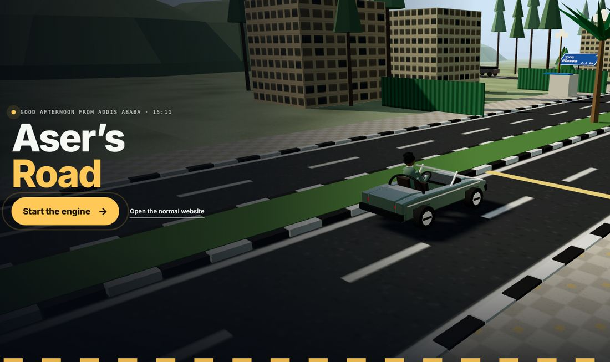
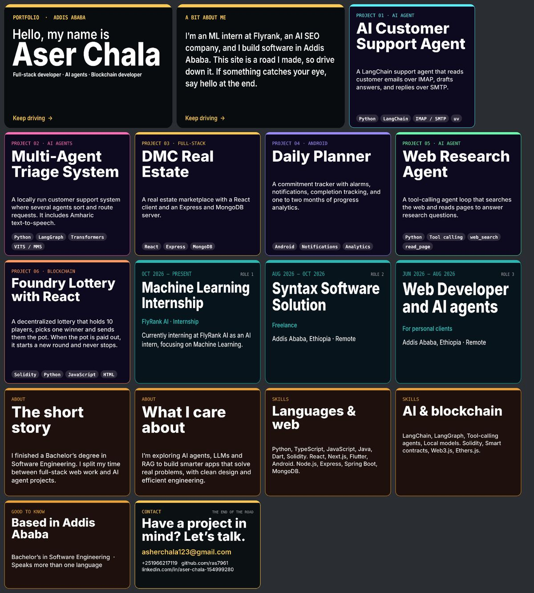
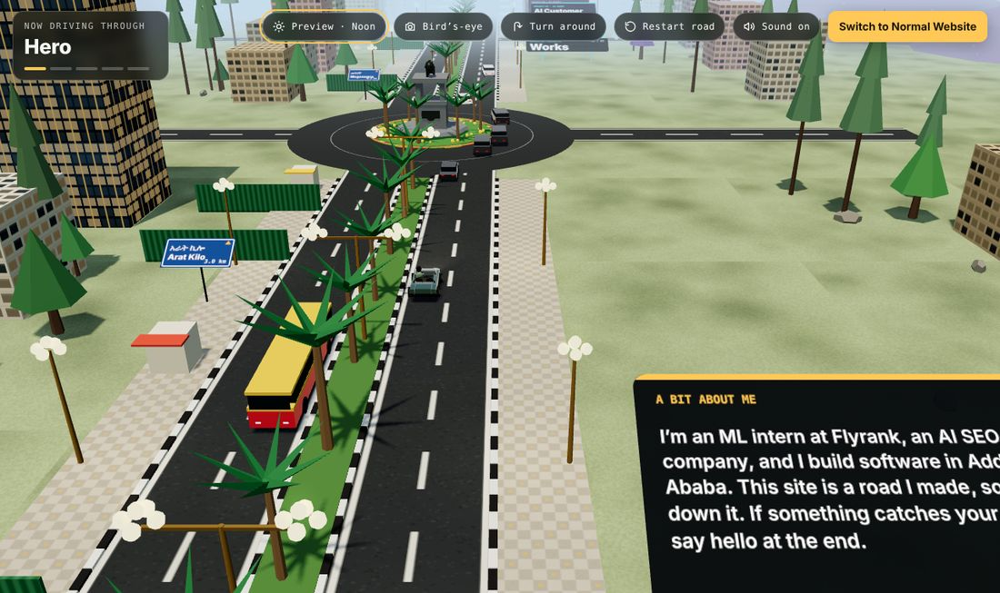
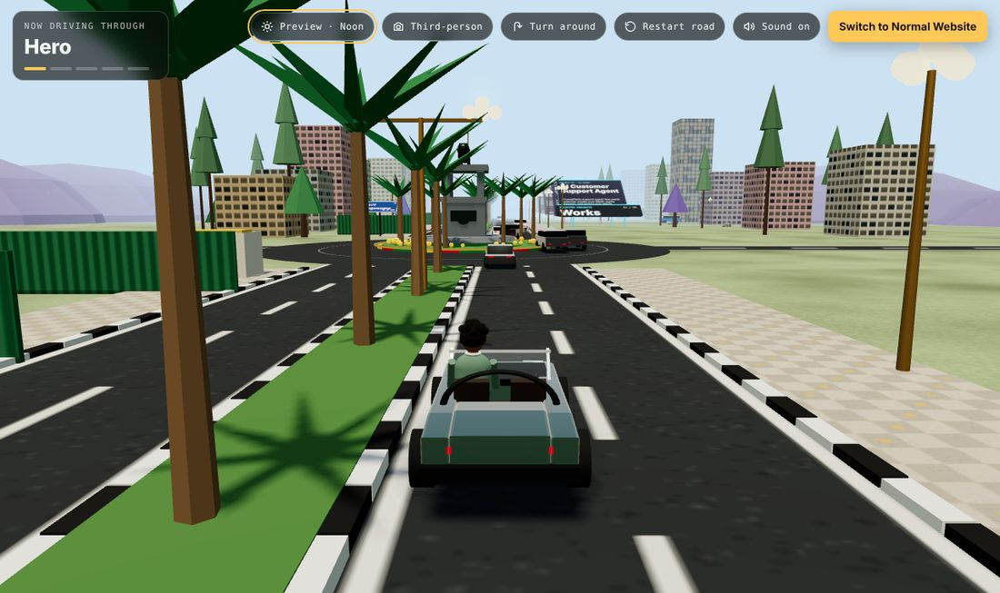
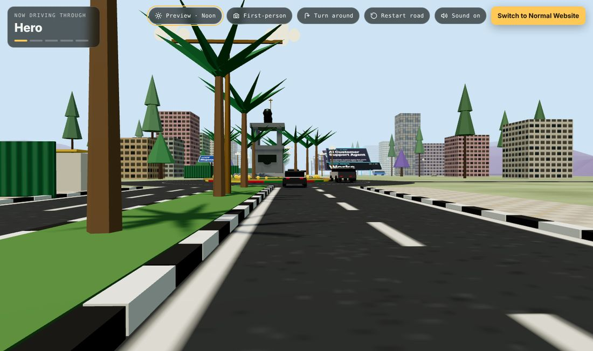
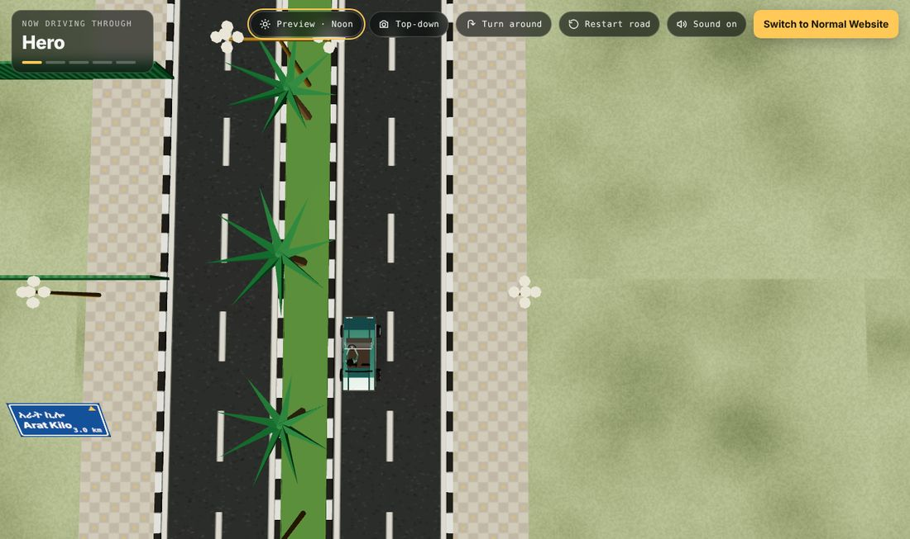
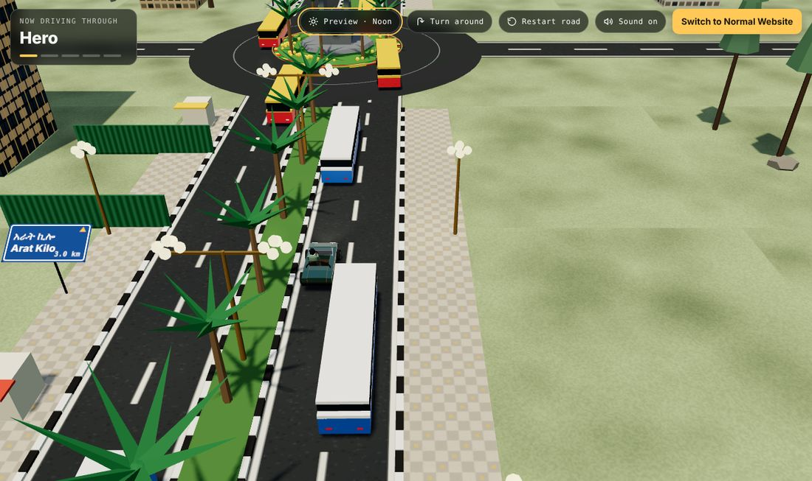
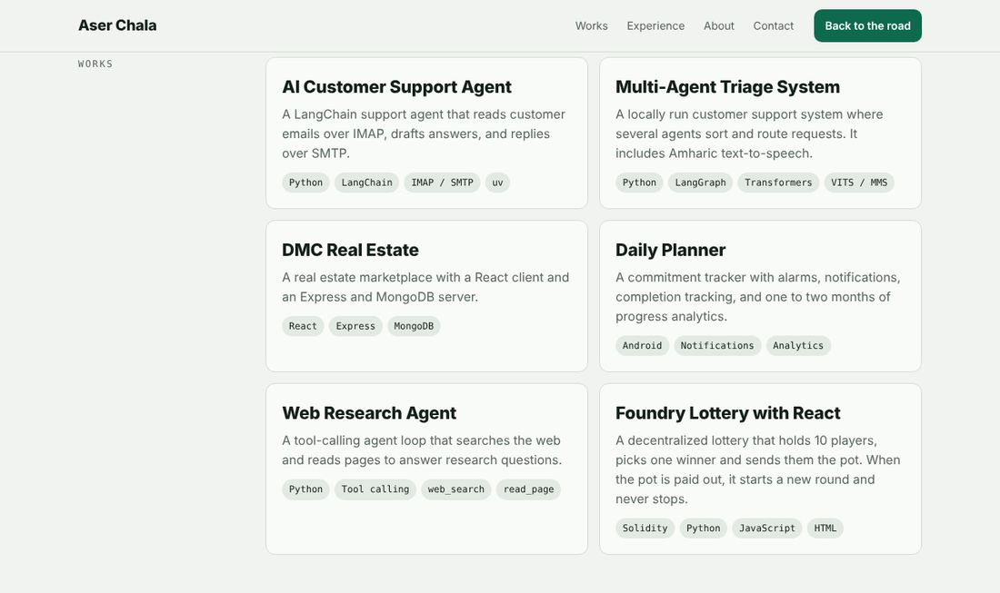
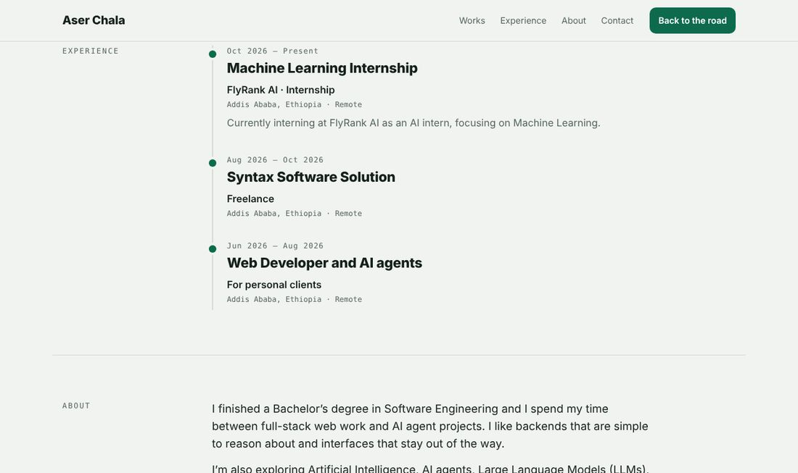

# Aser's Road

A portfolio you drive. Instead of scrolling a page, you drive a car down one long road in Addis Ababa. Each stop on the road is a section of the portfolio: Hero, Works, Experience, About and Contact. If you prefer a normal page, there is a regular scrolling website with the same content.

Built by **Aser Chala**: full-stack developer · AI agents · blockchain developer.



## Run it

1. Unzip the folder and keep its structure (`index.html`, `css/`, `js/`, `docs/`).
2. Double-click `index.html`. It opens straight from the folder and needs no build step or server.

You need an internet connection the first time: three.js and the Google Fonts load from a CDN.

To host it, upload the whole folder to any static host (GitHub Pages, Netlify, Vercel and so on). There is nothing to build.

## What you will see

### The five stops

1. **Hero:** "Hello, my name is Aser Chala" and a second billboard about me.
2. **Works:** six projects, each on its own billboard along the road.
3. **Experience:** three roles, newest first.
4. **About:** my story, what I care about, my skills and a few facts.
5. **Contact:** email, phone, GitHub and LinkedIn at the end of the road.



### Four camera views

Use the camera button at the top of the screen, or press **C**.

| Bird's-eye (default) | Third-person |
| --- | --- |
|  |  |
| **First-person** | **Top-down** |
|  |  |

### Addis Ababa traffic

The road is full of cars you would actually see in Addis: blue-and-white minibus taxis, blue-and-white Lada taxis, white sedans, Vitz-style hatchbacks, old Beetles, white pickups, red-and-yellow and blue city buses, and a few luxury cars and V8-style SUVs. Every car drives at its own speed, and the speed changes as it goes. When you press the horn, the cars ahead of you speed up and move to the next lane.



### The normal website

Press "Open the normal website" on the intro screen, or "Switch to Normal Website" while driving. "Back to the road" takes you back.




## Controls

| Key | What it does |
| --- | --- |
| **W** or **↑** | Go forward |
| **S** or **↓** | Brake, then reverse |
| **A / D** or **← / →** | Steer |
| **Space** or **Q** | Turn around |
| **H** | Horn |
| **C** | Change camera view |
| **R** | Restart the road from the beginning |
| **T** | Preview another time of day |
| **M** | Sound on or off |

The same actions are buttons at the top of the screen. At the end of the road, the contact box has "Turn around" and "Restart the road" buttons. On a phone or tablet, use the on-screen arrow buttons.

## Change the content

All the words live in one file: `js/content.js`. Edit it and reload the page. Both the road and the normal website read from it.

| Field | What it controls |
| --- | --- |
| `hello`, `name`, `tagline`, `intro` | The two hero billboards |
| `works` | Projects: `kind`, `title`, `desc`, `tags` |
| `experience` | Roles: `years`, `role`, `org`, `place`, `desc` |
| `about.story` / `about.roadStory` | The full text for the website and the short text for the road signs |
| `about.skillGroups`, `about.facts` | Skills and facts |
| `contact` | Call to action, email, phone, links |

Road signs have a fixed size, so keep text short: project descriptions fit about four lines, and the short About text about five.

## Project structure

```
aser-road/
├── index.html        page structure and the three.js loader
├── css/
│   └── style.css     all styling (intro, HUD, normal website)
├── js/
│   ├── content.js    all the portfolio words (edit this one)
│   ├── utils.js      small helpers (math, Addis time, clipboard)
│   ├── sfx.js        sound effects, synthesised with WebAudio
│   ├── site.js       the normal scrolling website
│   ├── textures.js   canvas textures for billboards and signs
│   ├── road.js       the 3D road: world, buildings, traffic, car, cameras, game loop
│   └── main.js       controls, intro screen, mode switching, start-up
└── docs/images/      the screenshots used in this README
```

The scripts are plain files, not ES modules, so the project works when opened straight from the folder. They must load in the order `index.html` lists them.

## How it works

- **3D:** [three.js](https://threejs.org) r158, loaded as an ES module from jsDelivr. The whole world is generated in code, with no model or texture files.
- **Billboards:** drawn on a canvas and used as textures.
- **Sound:** a quiet engine hum, a chime at each stop, a horn and soft bumps, all made with WebAudio. There are no audio files.
- **Performance:** the page lowers its quality by itself if the frame rate drops. If three.js or WebGL is not available, it falls back to the normal website.
- **Time of day:** the scene follows the real time in Addis Ababa (GMT+3), so it is dark at night. Press **T** to preview other times.

## Contact

- Email: asherchala123@gmail.com
- Phone: +251966217119
- GitHub: [github.com/ras7961](https://github.com/ras7961)
- LinkedIn: [linkedin.com/in/aser-chala-154999280](https://www.linkedin.com/in/aser-chala-154999280)
